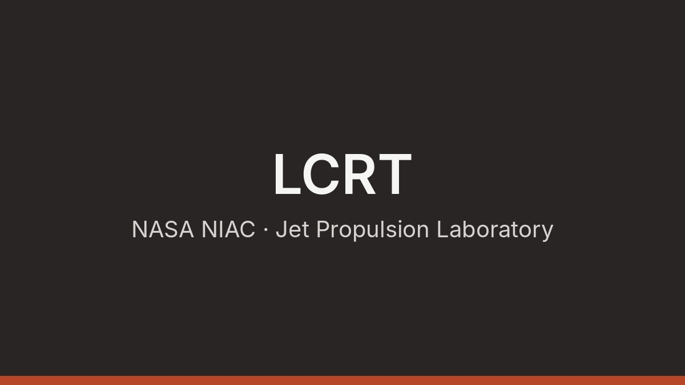

**Role:** Visiting Student Researcher, NASA Jet Propulsion Laboratory (Oct 2021 to Dec 2022)

## The project

The [Lunar Crater Radio Telescope](https://www-robotics.jpl.nasa.gov/what-we-do/research-tasks/lunar-crater-radio-telescope-lcrt-farside-moon/) (LCRT) is a NASA JPL concept for a radio telescope on the far side of the Moon. A 350 m wire mesh reflector would be deployed inside a lunar crater, with a receiver suspended at its focus. On the far side, the Moon shields the telescope from radio interference, and the absence of Earth's ionosphere opens wavelengths longer than 10 m, which cannot be observed from the ground. The goal is to detect the faint 21-cm signal of neutral hydrogen from the Cosmic Dark Ages, the epoch before the first stars formed.

## My contribution

I developed the science pipeline for the concept within its NIAC Phase II study.

- **Science forward model.** I built the model that predicts what LCRT would observe, as the basis for assessing its science return.
- **Signal extraction.** I integrated a pattern recognition pipeline into a simulated lunar observation framework, retrieving the Dark Ages signal to within 20 mK over a one-year mission, despite galactic foregrounds several orders of magnitude brighter.
- **Simulated datasets.** I generated training and test sets of sky observations from the lunar far side with the full LCRT antenna model, including crater morphology and the dielectric properties of the regolith.

This work received the NOVA Award from the Mobility and Robotics Systems section of NASA JPL in 2024.

## Outputs

- **Paper:** [Modelling Science Return from the Lunar Crater Radio Telescope on the Far Side of the Moon](https://doi.org/10.1098/rsta.2023.0073), Philosophical Transactions of the Royal Society A, 2024
- **Code and data:** [LCRT science model](https://doi.org/10.48577/jpl.D4SYJN), JPL Open Repository
- **Project page:** [Lunar Crater Radio Telescope on the Farside of the Moon](https://www-robotics.jpl.nasa.gov/what-we-do/research-tasks/lunar-crater-radio-telescope-lcrt-farside-moon/), JPL Robotics
